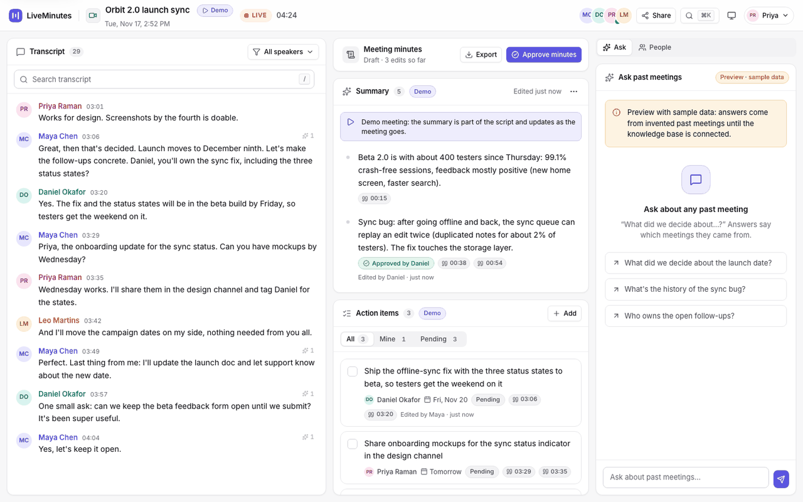
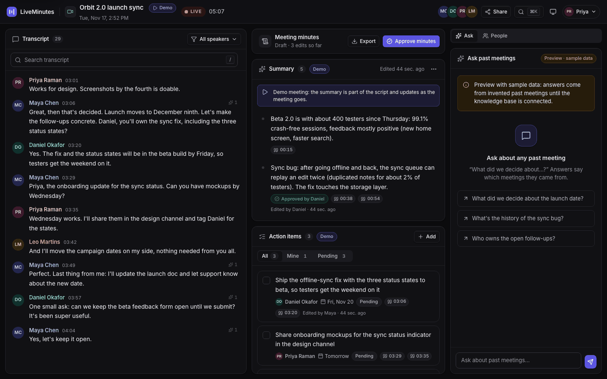
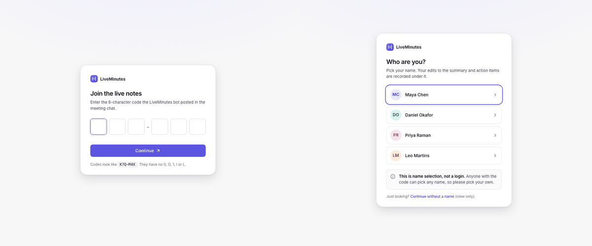
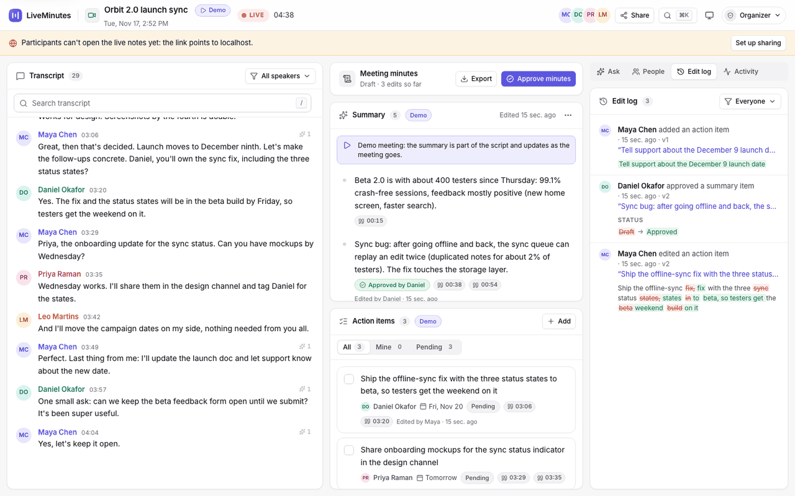
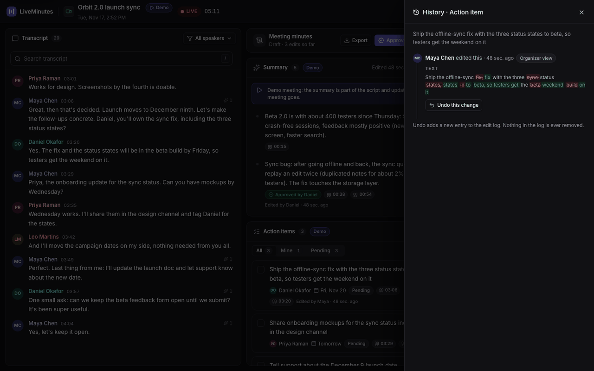
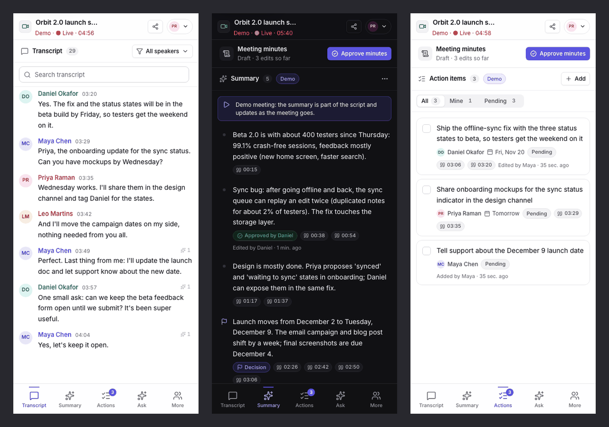

# LiveMinutes UI: shared live view, editing and Demo mode

The meeting page that everyone in the call can open, plus the organizer pages, all served by the bridge on port 8776. Code: [`1_ingestion/ui/`](../1_ingestion/ui/). Data contract for teammates: [UI_CONTRACT.md](UI_CONTRACT.md). Merging the LLM summary and knowledge base into it: [INTEGRATION.md](INTEGRATION.md).




## 1. How people get in

1. The bot joins, and everyone says yes in the meeting chat (the consent flow in [INGESTION.md](INGESTION.md)).
2. The bot posts one message: `Live notes for everyone: https://…/m/<meeting> (access code K7Q-M4X). …`
3. A participant opens the link and types the 6-character code.
   - The code has no 0/O, 1/I or L.
   - Paste works, and the QR code in the share dialog fills it in.
4. They pick their name from the people who said yes. **This is name selection, not a login**: anyone with the code can pick any of those names. The page says so, and so does this document. Edits are recorded under the picked name.
5. From then on the page is live: transcript lines, summary, action items, who is viewing and who is editing.



**When access stops:**
- `VIEW_ACCESS_DAYS` after the meeting ends (default 7).
- At once, if anyone says no: the bot leaves and the bridge deletes the session folder, including `access.json` and the edit log.
- When the organizer makes a new code (**Share → Make a new code**): everyone has to enter the new one.

**The organizer** opens http://localhost:8776/live:
- the list of meetings;
- **Start demo meeting** and **Send bot to a meeting**;
- the same meeting page for each meeting, plus three organizer-only tabs: **Edit log**, **Activity** (the bot's chat and consent events) and **Bot logs**.

The old pages are still there at `?classic=1`.

## 2. Sharing outside this computer

Participants need a public address for the bridge. For the prototype, use a free Cloudflare quick tunnel (no account):

```bash
brew install cloudflared        # macOS. Linux/Windows: https://developers.cloudflare.com/cloudflare-one/connections/connect-networks/downloads/
cd 1_ingestion && bash tunnel.sh
```

What `tunnel.sh` does:
1. Runs `cloudflared tunnel --url http://localhost:8776`.
2. Reads the `https://<random>.trycloudflare.com` address.
3. Gives it to the running bridge (`POST /live/api/public-url`), with no rebuild or restart. The bridge uses it straight away for:
   - the link and code the bot posts;
   - the share dialog;
   - its Origin check on writes (a participant's save must come from that address).

   It's kept in `sessions/.ui_public_url`, so it survives a bridge restart.
4. Waits until the new address answers (a few seconds), then prints it.

Ctrl+C stops the tunnel, and links go back to localhost.

Other options:
- Paste a tunnel address into **Share → Public address** in the organizer view.
- Set `PUBLIC_BASE_URL=https://…` in the repo's `.env` (see `.env.example`) and run `dc up -d`.

Quick tunnels get a new address every time, which is why there's a runtime setting. The value set while running wins over `PUBLIC_BASE_URL` in `.env`. Clearing it (`tunnel.sh` does on exit) falls back to `.env`.

**Quick tunnels don't pass the live stream on.** Cloudflare: "Quick Tunnels do not support Server-Sent Events (SSE)." So pages opened through one show the meeting from a normal request first, then switch to a long poll after 4 seconds without stream events. A long poll is a request that waits up to 20 s for news, then ends, so any proxy passes it. The header then says **Live · polling**, and updates still arrive within about a second. On localhost, or a named tunnel, the stream is used.

**The bare tunnel address** (`https://<random>.trycloudflare.com/`) shows a short page: "Open the link from your meeting chat".

**Without a public address**, links point to `http://localhost:8776` and only open on the organizer's computer. The organizer view shows a yellow banner about it.

**What the tunnel exposes:** only `/m/<meeting>/…` (the participant page and its API), `/static/…` and that short page at `/`. Everything else asked for through a tunnel gets 404:
- the organizer pages and every organizer API (sessions, meetings, demo start, public URL, a meeting's snapshot, edit log, rotate code, edits);
- Send bot;
- bot logs and data;
- the webhook;
- the audio websocket;
- `/health`.

A test (`test_every_route_but_the_participant_ones_is_blocked_through_a_tunnel`) tries every registered route through a tunnel. The real-tunnel browser test also checks the organizer pages from outside.

A request counts as "through a tunnel" when it carries proxy headers (`Cf-Connecting-Ip`, `X-Forwarded-For`, …) or uses a host name that isn't this computer.

## 3. The meeting page

| Area | What it does |
|---|---|
| **Header** | Meeting title (click to rename; logged), platform, Demo badge, a pulsing **Live** indicator or the recording state (Paused · waiting for Leo, Ended, Stopped), elapsed time. Participant avatars with a consent ring and "viewing now" dot (hover for details), **Share** (link, code, QR), ⌘K, theme, and who you are. |
| **Transcript** | Speaker names in a consistent color per person, timestamps, and new lines that slide in. Auto-scroll pauses when you scroll up, and a **Jump to live** pill counts new lines. Search with highlights (`/`), filter by speaker, styled "Multiple speakers" lines (Teams), and click to select a line. A small ✦ count marks lines cited by the summary. |
| **Summary** | Bullets and decisions. Source chips (`00:42`) scroll to and flash the transcript lines they came from. Edit inline, approve, view history, delete. |
| **Action items** | Cards with the task, owner (avatar), due date (overdue in red), status (Pending, Approved, Done; tick to finish) and source chips. Filters: All, Mine, Pending. **Add** a missing one. |
| **Minutes bar** | **Approve minutes** marks the record approved by name and time. If anything changes afterwards it shows "edited since". **Export** downloads Markdown. **Print or save as PDF** lays out real minutes (title, date, attendees, summary, decisions, action items with owners, edit-history note). |
| **Ask** | A chat-style box for questions about past meetings. Answers say which meetings they came from. It's labelled **Preview · sample data** until Ashmit's knowledge base replaces `ask_source()`. |
| **People** | Everyone, with consent state (said yes, via someone else, waiting, said no), "viewing now" and "editing". Participants can switch their name here. |

**Sample and Demo labels.** Until the summarizer is connected, real meetings show sample summary and action items, clearly labelled "Sample data" with a banner. Demo meetings are labelled "Demo" everywhere: badge, panels, export, print.

**States:** skeletons while loading; empty states for each panel and each meeting state; toasts (saved, undone, link copied, back online); and error screens for a wrong code, too many tries, expired, stopped (someone said no), not shared yet, not found, and connection lost (banner, then automatic reconnect).



## 4. Editing and the edit log

- **Inline edits:** summary text, and action item text, owner, due date and status. You can also approve, add an action item, delete (with Undo in the toast) and rename the meeting.
- **Append-only log:** every change is a new line in `sessions/<meeting>/edits.jsonl`: who, when, item, field, before, after, version. Nothing is overwritten or removed. Undo writes new lines that put the old values back.
- **Conflicts:** every item has a version. If two people edit the same item, the second save is refused, and a dialog shows **their version** next to **yours**: *Keep theirs*, *Edit again* or *Save mine*. While you edit, you see "Maya is editing this too" if someone else opens the same item. Everyone else sees "Maya is editing…" on it.
- **History drawer** (per item): every change with a word-level before/after diff, who and when, and **Undo this change** for the latest one.
- **Edit log tab** (organizer): the whole log, newest first, filterable by person; click an entry to jump to the item.



## 5. Demo mode

A scripted, realistic 5-minute product meeting ([`ui/fixtures/demo_meeting.json`](../1_ingestion/ui/fixtures/demo_meeting.json)) with four invented people. It covers consent, a late joiner who pauses recording (one line said during the pause is really dropped), a plan change (the launch date moves), summary updates and two action items.

It runs **through the real bridge code**:
- people join through `Bridge.on_join_leave`;
- the bot "joins" through `on_bot_state`;
- consent replies go through `on_chat`.

So the consent message, the gate, the late-joiner pause and the link-and-code message are the real ones. The only differences from a real meeting:
- there is no Attendee bot (its API calls are skipped for demo sessions);
- the transcript lines come from the script instead of Groq.

Three commands, with the bot stack set up as in [README section 7](../README.md#7-meeting-bot-optional-demo):

```bash
cd 1_ingestion && dc up -d                                    # if it isn't running
curl -s -X POST "http://localhost:8776/live/api/demo?wait=1"   # prints organizer link, participant link, code
open http://localhost:8776/live                               # or click "Start demo meeting" there
```

Options:
- `?speed=5` runs it 5× faster.
- `?until=200` stops the script at 3:20 and keeps the meeting live there (handy for pausing a demo or for screenshots).

Delete demo meetings any time: `rm -rf 1_ingestion/sessions/demo_*`.

## 6. Keyboard shortcuts

| Keys | Does |
|---|---|
| `/` | Search the transcript |
| `j` / `k` | Next / previous line or item (in the list you last used) |
| `e` | Edit the selected summary or action item |
| `⌘`/`Ctrl` + `↵` | Save an edit |
| `Esc` | Cancel the edit, close dialogs, clear the selection |
| `⌘`/`Ctrl` + `K` | Command palette: go to a panel, theme, export, print, copy link or code, approve, add an action item |
| `?` | Show shortcuts |

Everything is reachable by keyboard: visible focus rings, focus kept inside dialogs and given back, arrow keys in menus and tabs.

## 7. Design

- **Design system:** [`static/css/tokens.css`](../1_ingestion/ui/static/css/tokens.css) holds the colors, type scale, 4 px spacing, radius, shadows and motion.
- **Themes:** light and dark are designed separately. All text meets WCAG AA in both themes; axe-core checks every main screen in both.
- **Theme choice:** Light, Dark or System, remembered per browser, and set before the first paint, so there's no flash of the wrong theme.
- **Motion:** 140–250 ms, and off with `prefers-reduced-motion`.
- **Font:** Inter (variable, vendored).
- **Layouts:**
  - desktop (≥ 1200 px): three columns;
  - tablet (768–1199 px): two columns with tabs;
  - phone (< 768 px): one panel with tabs at the bottom, and edit buttons on the tapped item.
- **No build step:** plain ES modules and CSS, served as files. Nothing is loaded from a CDN.
- **Vendored files, with their licenses:**
  - Inter (OFL-1.1): `static/vendor/inter/`
  - qrcode-generator (MIT): `static/vendor/qrcode/`
  - Lucide icons (ISC): `static/vendor/lucide/`, used by `static/js/icons.js`
  - axe-core (MPL-2.0, tests only): `tests/vendor/axe/`



## 8. Security notes

- **Escaping:** all transcript and user text is shown with `textContent` (never `innerHTML`). The Markdown export escapes `< > | * _ [ ] # \` and backticks. Pages send a strict Content-Security-Policy (no inline scripts except one nonce'd theme line, no inline styles, `frame-ancestors 'none'`), `nosniff`, and `Referrer-Policy: same-origin`.
- **Writes:** every write needs a same-origin request (Origin / `Sec-Fetch-Site` checked) and a CSRF token:
  - participants: tied to their cookie;
  - organizer: a per-start token in the page.
- **Read only:** without the code you see nothing. With the code but no name you can read but not edit.
- **Access codes:** only a salted PBKDF2-SHA256 hash is stored (`sessions/<meeting>/access.json`). The plain code is kept in memory only, so the share dialog can show it. Codes are never logged.
- **Rate limits** (memory, per bridge):
  - code tries: 6 per 5 min per address and meeting, and 40 per hour per meeting;
  - saves: 90 per minute per viewer;
  - questions: 20 per minute.
- **The viewer cookie** is signed (HMAC-SHA256 with `UI_SECRET`, or a random key in `sessions/.ui_secret`), HttpOnly, SameSite=Lax, Secure over https, and scoped to `/m/<meeting>`. It's checked against the current code generation and expiry on every request.

## 9. Tests

From the repo root (packages: `requirements.txt` section 4):

```bash
.venv/bin/python -m pytest 1_ingestion/tests                   # unit + API tests (and the older unittest files)
.venv/bin/python -m playwright install chromium                # once, for the browser tests
.venv/bin/python -m pytest 1_ingestion/tests -m e2e            # browser tests: Demo, two participants, conflict, undo, approve, export, print, axe
.venv/bin/python 1_ingestion/tests/e2e/screenshots.py OUT_DIR  # every screen, light + dark, 1440/1024/768/390 px
```

**Contract test** (`tests/test_contract.py`): checks whatever is in `ui/adapters.py` against [UI_CONTRACT.md](UI_CONTRACT.md). Run it after plugging in real code (see [INTEGRATION.md](INTEGRATION.md)).

**Unit and API tests** (`tests/test_ui.py`) cover:
- access codes (right, wrong, rate limit, expiry, consent withdrawn, new code);
- the name cookie (signature, CSRF);
- permissions (no cookie, code but no name, tunnel requests, cross-site writes);
- the edit log (append only, versions, conflicts, undo, delete/restore, approval, bad input);
- XSS escaping, CSP, export, adapter and contract shapes, disk read-back, SSE, and the Demo consent flow.

**The browser tests** (`tests/e2e/`) run a real bridge web server. They fail on any console error, page error, failed request or HTTP 5xx.

## 10. Known limitations

- **Names aren't logins.** Anyone with the code can pick any consented name. Real sign-in (e.g. the meeting platform's own identity) is future work.
- **Sample data until teammates connect their code.** Summary and action items in real meetings are sample data until `summary_source()` / `actions_source()` are replaced; Ask is sample data until `ask_source()` is.
- **Rate limits, codes in memory and presence are per bridge process.** A bridge restart forgets them: the code still works (its hash is on disk), but the share dialog can't show it until the organizer makes a new one.
- **The organizer view is "whoever can open localhost:8776"** on the organizer's computer. That's the same trust model as the old live view.
- **Through a quick tunnel, updates come by long poll, not the stream** (Cloudflare doesn't pass Server-Sent Events on quick tunnels). That's about one request per change per viewer: fine for a meeting, but quick tunnels also cap 200 requests in flight, so a large audience needs a named Cloudflare tunnel or a real server.
- **Demo transcript lines are scripted.** The audio, cutting and Groq parts of the pipeline aren't exercised by Demo mode.
- **The meeting title is "Untitled meeting"** until someone renames it (the bot doesn't know the calendar title).
- **The bot still posts its older organizer-only link at join** (existing behavior, covered by an existing test), before the new link-and-code message.
